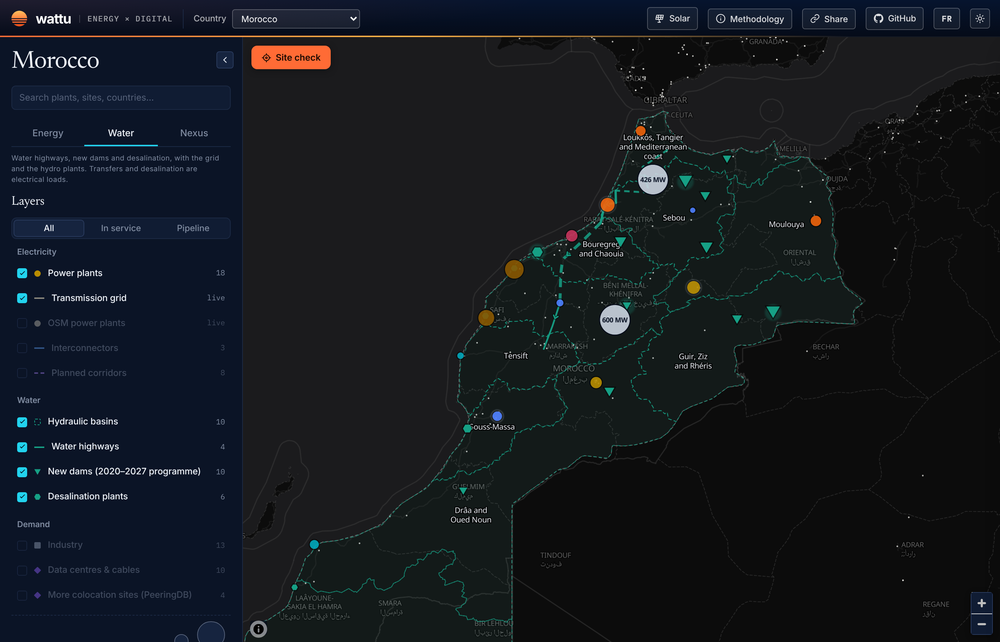
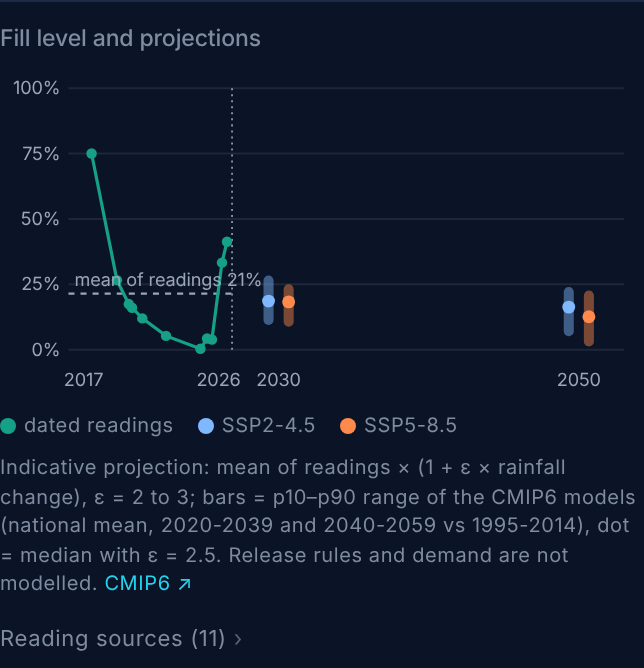

# Le Maroc déplace sa sécurité hydrique du ciel vers le réseau électrique

**Brouillon — S46 (13 nov. 2026). Version française de
2026-W46-substack.md. Sous-thèses 2 et 3. Angle à valider : chaque
mètre cube supplémentaire que le Maroc sécurise, qu'il soit pompé d'un
autre bassin ou tiré de la mer, est une charge que l'ONEE doit
planifier.**

---

En octobre 2024, Al Massira, deuxième retenue du pays, était remplie à
0,4 %. En 2017, elle l'était à 75 %. Marrakech avait pourtant toujours
de l'eau au robinet : depuis mars 2022, la ville est alimentée par une
conduite de 125 km pompée dans cette même retenue, avec trois stations
de pompage totalisant 27 MVA.

Tout le mouvement est là. Le Maroc construit un système hydrique qui
dépend moins de la pluie qui tombe là où vivent les gens, et davantage
de l'électricité : pour faire franchir les lignes de partage des eaux,
et pour dessaler l'eau de mer.

La carte le montre désormais. La nouvelle [perspective Eau de Wattu
Energy](https://energy.wattu.org/fr/#country=morocco&lens=water)
dessine les dix bassins hydrauliques, les autoroutes de l'eau qui les
relient, les barrages du programme 2020–2027 et chaque station de
dessalement, chacun avec sa source.

### 1. Les autoroutes de l'eau sont une infrastructure électrique

Le premier tronçon de l'autoroute de l'eau est entré en service en
août 2023. Il court sur 67 km, du barrage de garde du Sebou jusqu'à la
retenue Sidi Mohammed Ben Abdellah qui alimente Rabat et le nord de
Casablanca, à un débit pouvant atteindre 15 m³/s. Les autorités
attendent 350 à 400 millions de m³ transférés vers le sud chaque année.

Le deuxième tronçon est en appel d'offres. Les entreprises ont reçu le
cahier des charges en mars 2026 : 209,6 km de Sidi Mohammed Ben
Abdellah à Al Massira, 30 m³/s, trois stations de pompage et un tunnel
de 68 km. Au-delà, une étude de conception porte sur l'extrémité nord :
près d'un milliard de m³ par an mobilisables du Laou et du Loukkos
jusqu'à Al Massira, avec jusqu'à 45 m³/s pour l'ensemble de la chaîne.

Chacun de ces ouvrages est une charge de pompage sur le réseau. Aucun
ne publie sa puissance appelée. Sur la carte, le popup de chaque bassin
indique ce qu'il envoie et ce qu'il reçoit. Le Sebou envoie. L'Oum
Er-Rbia recevra la phase II et alimente Marrakech. Mis bout à bout, le
réseau hydraulique se planifie comme une dorsale, à la manière du
réseau 400 kV.

### 2. Le dessalement devient la base du mix hydrique

En service aujourd'hui, les stations de dessalement de la carte
produisent environ 119 millions de m³ par an. Ce chiffre exclut les
stations OCP de Jorf Lasfar et de Safi, qui ne publient pas de chiffre
par site : OCP Green Water déclarait 340 millions de m³ par an pour
l'ensemble de ses stations au 30 juin 2026. S'y ajoutent 337 millions
de m³ par an en construction. La station de Casablanca-Settat pèse à
elle seule 300 millions de m³ par an à terme ; sa première tranche est
attendue en février 2027, et un nouveau raccordement 400 kV avec un
poste de 300 MVA est déjà sous tension.

À 3,5 kWh par m³ (osmose inverse d'eau de mer, de la prise d'eau au
stockage), cela représente environ 48 MW de charge moyenne pour les
stations dont la capacité est publiée, et 182 MW une fois les chantiers
terminés. Les 340 millions de m³ d'OCP ajouteraient à peu près 135 MW.
Au total, environ 4 % de la pointe record de 8,4 GW relevée par l'ONEE
en juillet 2026. C'est peu en soi, mais c'est une charge nouvelle qui
tourne à toute heure de l'année.

Contrairement à un data center, elle peut se déplacer dans la journée.
Une chaîne d'osmose inverse peut tourner à plein à midi et ralentir à
la pointe du soir, pourvu qu'il y ait du stockage derrière. La station
de Dakhla a été conçue autour d'un parc éolien dédié de 60 MW. Un
réservoir d'eau coûte moins cher qu'une batterie : le dessalement est
l'effacement industriel que la sous-thèse 3 dit que personne ne
valorise encore.

[GRAPHIQUE : barres empilées par année, 2020–2030 — capacité de
dessalement en service et engagée (millions de m³/an, axe de gauche) et
charge électrique moyenne correspondante à 3,5 kWh/m³ (MW, axe de
droite), avec OCP isolé sous la mention « total du groupe, pas de
chiffre par station ».]

### 3. Les barrages remplissent un seau plus petit

Le programme 2020–2027 ajoute sur la carte environ 2 039 millions de m³
de stockage en service et 2 164 millions de m³ en construction, dont
Kheng Grou (1 070 millions de m³, mise en eau à partir de
décembre 2026) et Ratba (1 009 millions de m³, à peu près à mi-chemin).

Mais capacité de stockage ne veut pas dire apports. L'ensemble CMIP6
de la Banque mondiale donne pour le Maroc une variation médiane des
précipitations annuelles d'environ −5 % en 2030, pour SSP2-4.5 comme
pour SSP5-8.5, et de −10 % (SSP2-4.5) à −16 % (SSP5-8.5) en 2050, par
rapport à 1995–2014. Dans les bassins semi-arides, le ruissellement
baisse deux à trois fois plus vite que la pluie. Avec une élasticité de
2,5, cela fait −24 % à −41 % d'apports au milieu du siècle. Les modèles
du 10ᵉ centile vont beaucoup plus loin.

Le popup de chaque barrage affiche désormais cette projection à côté de
son historique de remplissage. Pour Al Massira, les relevés datés
depuis 2017 donnent une moyenne de 21 %. Passée à la médiane 2050,
cette moyenne tombe à environ 16 % (SSP2-4.5) ou 12 % (SSP5-8.5).

L'hydroélectricité suit. Quand Bin el Ouidane était rempli à moins de
5 % en 2025, sa centrale de 135 MW ne produisait plus que 45 MW. Un
bassin plus sec, ce sont moins de GWh sortis des barrages, et davantage
de GWh consommés par les pompes et les membranes qui les remplacent.

### La tension : 2026 a été une année humide

Le contre-argument est à la une de tous les journaux cette année. Les
réserves ont dépassé 70 % au printemps 2026. Bin el Ouidane a atteint
94,6 % en avril, son plus haut niveau depuis onze ans. Oued El Makhazine
était à 147 % de sa capacité normale en février. Al Massira est passé
de 3,9 % à 41,3 % en douze mois.

Une année humide ne fait pas une tendance. Les fourchettes CMIP6 sont
larges : les modèles du 90ᵉ centile voient un 2030 légèrement plus
humide. Et une élasticité fixe est un outil grossier : elle ne modélise
ni les règles de lâcher ni la demande d'irrigation. La bande 2050 du
graphique est un ordre de grandeur, pas une prévision.

Mais le rebond de 2026 confirme justement le point sur la
planification. Un système qui passe de 0,4 % à 41 % dans sa deuxième
retenue en moins de deux ans ne se planifie pas sur des années
moyennes. Les autoroutes de l'eau et le dessalement sont la réponse de
l'État à cette variance. Et les deux se paient en électricité.

### Ce que cela implique pour l'ONEE

L'ONEE, c'est l'Office National de l'Électricité *et de l'Eau potable*.
Le même établissement exploite les adductions d'eau potable, porte les
concessions de dessalement et gère le réseau de transport qui va les
alimenter. Peu de compagnies au monde ont les deux côtés de l'arbitrage
eau–énergie dans un même bilan.

Cela peut jouer dans les deux sens. L'ONEE peut planifier stations de
pompage et chaînes d'osmose inverse comme des charges flexibles,
implantées là où le réseau 400 kV a de la marge et programmées en
fonction du solaire. Ou les traiter comme des charges fixes, greffées
sur un plan de réseau dessiné pour les usines et, désormais, pour les
data centers.

Le plan réseau 2026–2030 s'écrit en ce moment. Combien de mégawatts
d'eau contient-il, et l'un d'eux a-t-il le droit de se déplacer ?

---

### Sources

- Autoroute de l'eau Sebou–Bouregreg, 67 km, 15 m³/s, premiers mètres cubes le 28 août 2023 — L'Économiste, <https://weekly.leconomiste.com/in-the-pipes-of-the-water-highway/>
- Appel d'offres de la phase II : 209,6 km, 30 m³/s, 3 stations de pompage, tunnel de 68 km — TelQuel, 31 mars 2026, <https://telquel.ma/2026/03/31/autoroute-de-leau-ce-que-le-cahier-des-charges-revele-de-la-phase-ii-du-projet_1981667>
- Étude Laou–Loukkos–Sebou — Médias24, 9 mai 2025, <https://medias24.com/2025/05/09/un-projet-dinterconnexion-des-bassins-du-laou-du-loukkos-et-du-sebou-et-de-transfert-vers-le-barrage-al-massira-a-letude/>
- Adduction Al Massira–Marrakech, 125 km, 7 m³/s, 27 MVA — ONEE via Smart Water Magazine, <https://smartwatermagazine.com/news/smart-water-magazine/morocco-commissions-drinking-water-project-marrakech>
- Dessalement de Casablanca-Settat, raccordement 400 kV, 300 MVA — ONEE via Fedenerg, 28 juil. 2026, <https://www.fedenerg.ma/2026/07/28/onee-mise-en-service-des-ouvrages-400-kv-destines-a-lalimentation-electrique-de-la-station-de-dessalement-de-la-region-casablanca-settat/>
- OCP Green Water, 340 millions de m³/an au 30 juin 2026 — Le Desk, 5 oct. 2026, <https://ledesk.ma/2026/10/05/ocp-prepare-louverture-de-ses-societes-de-dessalement-a-des-investisseurs-exterieurs/>
- Dessalement de Dakhla et parc éolien de 60 MW — Le360, <https://fr.le360.ma/economie/la-station-de-dessalement-de-dakhla-a-97-de-realisation_K4LXFWTWKBBGBBHECL2TAKXIPU/>
- Pointe record de 8,4 GW, 27 juil. 2026 — conseil d'administration de l'ONEE via TelQuel, <https://telquel.ma/instant-t/2026/07/28/electricite-le-maroc-enregistre-un-nouveau-record-historique-de-consommation_2001082>
- Al Massira de 75 % (2017) à 0,4 % (oct. 2024) — Le360 (données Maa Dialna), <https://fr.le360.ma/societe/barrage-al-massira-le-deuxieme-plus-grand-ouvrage-hydrique-du-maroc-a-un-niveau-inedit-de-secheresse_NOSIBNR5FBDYXNDDOW4UHYJOSM/>
- Al Massira de 3,9 % à 41,3 % en un an — Le360, <https://fr.le360.ma/societe/de-39-a-413-en-chiffres-voici-comment-le-barrage-al-massira-a-decuple-son-stock-en-un-an_F6EUM2YPIVHKTGD2FFR3KOQSII/>
- Bin el Ouidane à 94,6 %, centrale à 45 MW l'année précédente — Le360, <https://fr.le360.ma/economie/le-barrage-bin-el-ouidane-atteint-94-de-remplissage-et-reprend-sa-production-electrique_LETLBOFWSNE7TKTAIQBRGKTYJM/>
- Oued El Makhazine à 146,85 % — Médias24, 4 févr. 2026, <https://medias24.com/2026/02/04/barrage-oued-el-makhazine-le-directeur-general-hydraulique-fait-le-point-1622467/>
- Kheng Grou à 91 %, mise en eau en déc. 2026 — Le360, <https://fr.le360.ma/economie/barrage-de-kheng-grou-a-figuig-les-travaux-atteignent-91-livraison-prevue-avant-fin-2026_PESLRS3UTZADXMTJTW4JMTOXCU/>
- Projections de précipitations CMIP6, Maroc, ensemble 0,25° — Banque mondiale, Climate Change Knowledge Portal, <https://climateknowledgeportal.worldbank.org/country/morocco/climate-data-projections>
- Contours des bassins — HydroBASINS v1c (Lehner & Grill 2013), <https://www.hydrosheds.org/products/hydrobasins>
- Chaque chiffre ci-dessus, actif par actif, avec sa source : <https://energy.wattu.org/fr/#country=morocco&lens=water>

*Note de méthode pour Reda (à supprimer avant publication) : la
projection est la moyenne des relevés datés × (1 + ε × ΔP), avec
ε = 2 à 3 et la variation CMIP6 nationale. L'élasticité de 2,5 est le
milieu de la fourchette semi-aride habituelle, pas un calage marocain.
La part d'environ 4 % de la pointe ajoute une estimation OCP (environ
135 MW pour 340 Mm³/an à 3,5 kWh/m³) aux 182 MW de la carte. La tuile
de la carte affiche 2 % parce qu'elle exclut OCP. Vérifier le chiffre
de 45 MW de Bin el Ouidane auprès de l'ONEE avant de le citer.*
