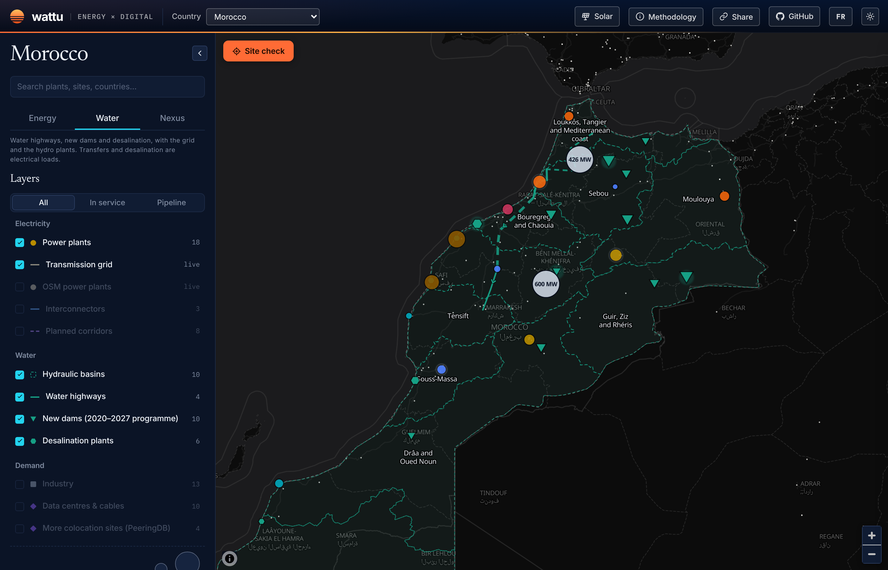
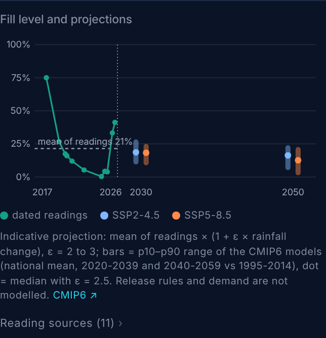

# Morocco is moving its water security from the sky to the grid

**Draft — W46 (13 Nov 2026). Thesis sub-claims 2 and 3. Angle to approve:
every new cubic metre Morocco secures, whether pumped from another basin
or taken from the sea, is a load ONEE has to plan for.**

---

In October 2024 Al Massira, the country's second-largest reservoir, held
0.4% of its capacity. In 2017 it had held 75%. Marrakech still had
drinking water, because since March 2022 it has been fed by a 125 km
pipe pumped out of that same reservoir: three pumping stations, 27 MVA.

That is the shape of what is happening. Morocco is building a water
system that depends less on rain falling where people live, and more on
electricity: to lift water over watersheds, and to strip the salt out of
seawater.

The map now shows it. The new [Water view on Wattu Energy](https://energy.wattu.org/#country=morocco&lens=water)
draws the ten hydraulic basins, the water highways between them, the
dams of the 2020–2027 programme and every desalination plant, each with
its source.

### 1. The water highways are electrical infrastructure

The first section of the "autoroute de l'eau" opened in August 2023. It
runs 67 km from the Sebou guard dam to the Sidi Mohammed Ben Abdellah
reservoir that supplies Rabat and northern Casablanca, at up to 15 m³/s.
Officials expect 350–400 million m³ a year to move south through it.

The second section is in tender. Contractors received the specifications
in March 2026: 209.6 km from Sidi Mohammed Ben Abdellah to Al Massira,
30 m³/s, three pumping stations and a 68 km tunnel. Beyond it, a design
study is looking at the northern end: nearly 1 billion m³ a year from
the Laou and Loukkos down to Al Massira, up to 45 m³/s for the whole
chain.

Each of these is a pumping load on the grid. None of them publishes its
power demand. On the map, the basin popups list what each basin sends
and receives. The Sebou sends. Oum Er-Rbia receives the planned
phase II and sends to Marrakech. Read together, the water network is
being planned as a backbone, much as the 400 kV grid was.

### 2. Desalination is the new base load in the water mix

In service today, the desalination plants on the map produce about
119 million m³ a year. That figure leaves out OCP's Jorf Lasfar and Safi
plants, which publish no per-site figure. OCP Green Water reported
340 million m³ a year across all its plants at 30 June 2026. Another
337 million m³ a year is under construction. Casablanca-Settat alone is
300 million m³ a year at full build-out, with a first tranche expected
in February 2027 and a new 400 kV connection and a 300 MVA substation
already energised.

At 3.5 kWh per m³ (seawater reverse osmosis, intake to storage), that
is about 48 MW of average load for the plants with a published
capacity, and 182 MW once the pipeline is built. OCP's 340 million m³
would add roughly another 135 MW. Together that is about 4% of the
8.4 GW record peak ONEE logged in July 2026: small on its own, but new
load that runs every hour of the year.

Unlike a data centre, it can move within the day. A reverse-osmosis
train can run at full output at noon and slow down at the evening
peak, as long as there is storage behind it. Dakhla's plant was built
around a dedicated 60 MW wind farm. Water tanks are cheaper than
batteries, which makes desalination the industrial demand response that
sub-claim 3 says nobody is pricing.

[CHART: stacked bars by year, 2020–2030 — desalination capacity in
service and committed (million m³/yr, left axis) and the matching
average electrical load at 3.5 kWh/m³ (MW, right axis), with OCP shown
separately as "group total, no per-plant figure".]

### 3. The dams are filling a smaller bucket

The 2020–2027 programme adds about 2,039 million m³ of new storage in
service and 2,164 million m³ under construction on the map. That
includes Kheng Grou (1,070 million m³, impounding from December 2026)
and Ratba (1,009 million m³, about half built).

Storage is not inflow. The World Bank's CMIP6 ensemble puts Morocco's
median annual rainfall change at about −5% for 2030 under both SSP2-4.5
and SSP5-8.5, and −10% (SSP2-4.5) to −16% (SSP5-8.5) for 2050, against
1995–2014. In semi-arid catchments runoff falls two to three times
faster than rain. At an elasticity of 2.5, that is −24% to −41% of
inflow by mid-century. The 10th-percentile models go much further.

Each dam's popup now carries that projection next to its fill history.
For Al Massira, the dated readings since 2017 average 21% full. Run
through the 2050 median, that average becomes about 16% (SSP2-4.5) or
12% (SSP5-8.5).

The hydro side follows. When Bin el Ouidane was below 5% full in 2025,
its 135 MW plant was down to 45 MW. A drier basin means fewer GWh from
the dams, and more GWh into the pumps and membranes that replace them.

### The tension: 2026 was wet

The counter-argument is on every front page this year. Reserves passed
70% in the spring of 2026. Bin el Ouidane reached 94.6% in April, its
highest level in eleven years. Oued El Makhazine stood at 147% of its
normal capacity in February. Al Massira climbed from 3.9% to 41.3% in
twelve months.

One wet year is not a trend. The CMIP6 ranges are wide. The p90 models
see a slightly wetter 2030. And a fixed elasticity is a blunt tool: it
models neither release rules nor irrigation demand. The 2050 band on
the chart is an order of magnitude, not a forecast.

But the 2026 rebound proves the point about planning. A system that
swings from 0.4% to 41% at its second-largest reservoir in under two
years cannot be planned on average years. The water highways and the
desalination plants are the government's answer to the variance. Both
are paid for in electricity.

### What it means for ONEE

ONEE is the Office National de l'Électricité *et de l'Eau potable*. The
same utility runs the drinking-water mains, the desalination
concessions and the transmission grid that will feed them. Few
utilities anywhere hold both sides of the water–energy trade-off in one
balance sheet.

That cuts both ways. It could plan pumping stations and reverse-osmosis
trains as flexible load, sited where the 400 kV grid has headroom and
scheduled against solar. Or it could treat them as fixed load bolted
onto a grid plan drawn for factories and, now, data centres.

The 2026–2030 grid plan is being written now. How many megawatts of
water does it contain, and are any of them allowed to move?

---

### Sources

- Sebou–Bouregreg water highway, 67 km, 15 m³/s, first water 28 Aug 2023 — L'Économiste, <https://weekly.leconomiste.com/in-the-pipes-of-the-water-highway/>
- Phase II tender: 209.6 km, 30 m³/s, 3 pumping stations, 68 km tunnel — TelQuel, 31 Mar 2026, <https://telquel.ma/2026/03/31/autoroute-de-leau-ce-que-le-cahier-des-charges-revele-de-la-phase-ii-du-projet_1981667>
- Laou–Loukkos–Sebou design study — Médias24, 9 May 2025, <https://medias24.com/2025/05/09/un-projet-dinterconnexion-des-bassins-du-laou-du-loukkos-et-du-sebou-et-de-transfert-vers-le-barrage-al-massira-a-letude/>
- Al Massira–Marrakech main, 125 km, 7 m³/s, 27 MVA — ONEE via Smart Water Magazine, <https://smartwatermagazine.com/news/smart-water-magazine/morocco-commissions-drinking-water-project-marrakech>
- Casablanca-Settat desalination, 400 kV connection, 300 MVA — ONEE via Fedenerg, 28 Jul 2026, <https://www.fedenerg.ma/2026/07/28/onee-mise-en-service-des-ouvrages-400-kv-destines-a-lalimentation-electrique-de-la-station-de-dessalement-de-la-region-casablanca-settat/>
- OCP Green Water, 340 million m³/yr at 30 Jun 2026 — Le Desk, 5 Oct 2026, <https://ledesk.ma/2026/10/05/ocp-prepare-louverture-de-ses-societes-de-dessalement-a-des-investisseurs-exterieurs/>
- Dakhla desalination and 60 MW wind farm — Le360, <https://fr.le360.ma/economie/la-station-de-dessalement-de-dakhla-a-97-de-realisation_K4LXFWTWKBBGBBHECL2TAKXIPU/>
- Record peak 8.4 GW, 27 Jul 2026 — ONEE board via TelQuel, <https://telquel.ma/instant-t/2026/07/28/electricite-le-maroc-enregistre-un-nouveau-record-historique-de-consommation_2001082>
- Al Massira 75% (2017) to 0.4% (Oct 2024) — Le360 (Maa Dialna), <https://fr.le360.ma/societe/barrage-al-massira-le-deuxieme-plus-grand-ouvrage-hydrique-du-maroc-a-un-niveau-inedit-de-secheresse_NOSIBNR5FBDYXNDDOW4UHYJOSM/>
- Al Massira 3.9% to 41.3% in a year — Le360, <https://fr.le360.ma/societe/de-39-a-413-en-chiffres-voici-comment-le-barrage-al-massira-a-decuple-son-stock-en-un-an_F6EUM2YPIVHKTGD2FFR3KOQSII/>
- Bin el Ouidane 94.6%, plant at 45 MW the year before — Le360, <https://fr.le360.ma/economie/le-barrage-bin-el-ouidane-atteint-94-de-remplissage-et-reprend-sa-production-electrique_LETLBOFWSNE7TKTAIQBRGKTYJM/>
- Oued El Makhazine 146.85% — Médias24, 4 Feb 2026, <https://medias24.com/2026/02/04/barrage-oued-el-makhazine-le-directeur-general-hydraulique-fait-le-point-1622467/>
- Kheng Grou 91%, impounding Dec 2026 — Le360, <https://fr.le360.ma/economie/barrage-de-kheng-grou-a-figuig-les-travaux-atteignent-91-livraison-prevue-avant-fin-2026_PESLRS3UTZADXMTJTW4JMTOXCU/>
- CMIP6 rainfall projections, Morocco, 0.25° ensemble — World Bank Climate Change Knowledge Portal, <https://climateknowledgeportal.worldbank.org/country/morocco/climate-data-projections>
- Basin outlines — HydroBASINS v1c (Lehner & Grill 2013), <https://www.hydrosheds.org/products/hydrobasins>
- Every figure above, per asset, with its own source: <https://energy.wattu.org/#country=morocco&lens=water>

*Method note for Reda (delete before publishing): the projection is
mean of dated readings × (1 + ε × ΔP), ε = 2–3, national CMIP6 change.
The 2.5 elasticity is the mid of the usual semi-arid range, not a
Moroccan calibration. The ~4% share of peak adds an OCP estimate (about
135 MW from 340 Mm³/yr at 3.5 kWh/m³) to the map's 182 MW. The map's
own KPI tile shows 2% because it excludes OCP. Check the Bin el
Ouidane 45 MW figure against ONEE before quoting it.*
